# ✈️ Quando voar para não atrasar? Pontualidade dos voos domésticos brasileiros

**MVP: Pipeline de dados em nuvem** · Departamento de Engenharia de Produção · Universidade de Brasília
Prof. André Luiz Marques Serrano · Aluna: **Maria Clara Souza Flores** · Matrícula: **221006683**

Pipeline de dados construído no **Databricks Free Edition**. Ele coleta os dados oficiais de voos da ANAC, organiza os
dados num **esquema estrela** e responde a perguntas de negócio sobre **atrasos e cancelamentos** da aviação doméstica.
O foco é **Brasília (BSB)**.

> **Como ler este README:** ele segue a ordem das etapas do trabalho (Objetivo → Coleta → Modelagem → Carga → Análise
> → Autoavaliação). Cada etapa aponta para o notebook que a executa e para as evidências (prints) em `/evidencias`.

---

## Sumário
1. [Objetivo](#1-objetivo)
2. [Arquitetura do pipeline](#2-arquitetura-do-pipeline)
3. [Busca e coleta dos dados](#3-busca-e-coleta-dos-dados)
4. [Modelagem](#4-modelagem)
5. [Carga (ETL)](#5-carga-etl)
6. [Análise de qualidade dos dados](#6-análise-de-qualidade-dos-dados)
7. [Solução do problema: respostas às perguntas](#7-solução-do-problema-respostas-às-perguntas)
8. [Discussão geral](#8-discussão-geral)
9. [Viabilidade do MVP](#9-viabilidade-do-mvp)
10. [Ética, licença e proteção de dados](#10-ética-licença-e-proteção-de-dados)
11. [Autoavaliação](#11-autoavaliação)

---

## 1. Objetivo

### 1.1 Problema
Atrasos e cancelamentos de voos geram custo para os passageiros (compromissos perdidos, conexões, diárias) e para as
empresas que compram viagens corporativas. Brasília tem um aeroporto de conexão e muitos deslocamentos a trabalho para
órgãos públicos. Por isso, **escolher bem o horário, a companhia e a rota** é uma decisão com impacto direto.

Mesmo assim, essas escolhas costumam ser feitas só por preço e conveniência, sem olhar o histórico de pontualidade,
que é público e está disponível nos dados oficiais da ANAC.

**Problema do MVP:** *usar os dados públicos de voos para descobrir quais fatores (horário, companhia, aeroporto,
época do ano e rota) estão associados a maior risco de atraso e cancelamento nos voos domésticos, com atenção
especial aos voos que saem de Brasília.*

**Usuário-alvo:** gestores de viagens corporativas e passageiros frequentes que saem de Brasília.
**Decisão apoiada:** em que horário, por qual companhia e em quais rotas comprar passagens para reduzir o risco de
atraso.

### 1.2 Hipótese central
> **H1 (efeito cascata):** um atraso no primeiro voo do dia se propaga para os voos seguintes da mesma aeronave.
> Por isso, **voos programados para a manhã atrasam significativamente menos do que voos programados para a noite.**
>
> **Métrica que confirma ou refuta:** diferença entre a taxa de atraso > 30 min da faixa Noite e a da faixa Manhã,
> com teste z para duas proporções (nível de significância de 5%).

### 1.3 Perguntas de negócio
| # | Pergunta | Decisão que ela apoia |
|---|---|---|
| **P1** | Quais companhias aéreas têm as maiores taxas de atraso (> 30 min) e de cancelamento? | Escolher a companhia |
| **P2** | Entre os 15 aeroportos mais movimentados, quais têm a pior pontualidade de partida, e como Brasília se posiciona? | Avaliar o risco do aeroporto e de conexões |
| **P3** | O risco de atraso cresce ao longo do dia? A hipótese H1 se sustenta? | Escolher o horário do voo |
| **P4** | Existe sazonalidade, ou seja, meses ou dias da semana com pontualidade pior? | Planejar viagens e folgas na agenda |
| **P5** | Saindo de Brasília, quais rotas têm maior risco de atraso ou cancelamento? | Escolher a rota ou a conexão |

**Definições usadas em todas as respostas** (critério da ANAC):
- **Voo atrasado:** partida real mais de **30 minutos** depois da partida prevista.
- **Taxa de atraso:** voos atrasados ÷ voos realizados.
- **Taxa de cancelamento:** voos cancelados ÷ voos programados.

### 1.4 Por que isto é um MVP (e não só um protótipo)
| Dimensão | Evidência neste trabalho |
|---|---|
| **Viabilidade técnica** | Pipeline ponta a ponta no Databricks: coleta, camadas Bronze/Silver/Gold e análise |
| **Viabilidade financeira** | Custo de operação **R$ 0** no Free Edition e estimativa de custo em produção (seção 9) |
| **Desejabilidade** | As perguntas respondem a decisões reais de compra de passagem (seção 7) |

---

## 2. Arquitetura do pipeline

Arquitetura em camadas (*medallion*): **Bronze** guarda a cópia fiel da origem, **Silver** guarda os dados limpos e
tipados, e **Gold** guarda o esquema estrela usado na análise.

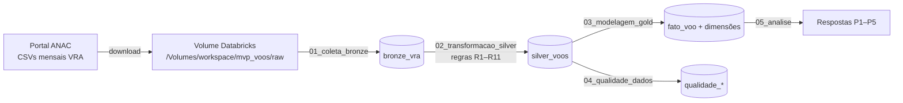

| Notebook | Etapa do trabalho | Saída na nuvem |
|---|---|---|
| `00_config` | Configuração | Schema `workspace.mvp_voos` e Volume `raw` |
| `01_coleta_bronze` | Coleta e carga bruta | `bronze_vra`, `log_coleta` |
| `02_transformacao_silver` | Transformação (ETL) | `silver_voos`, `log_funil_transformacao` |
| `03_modelagem_gold` | Modelagem e carga final | `fato_voo`, `dim_empresa`, `dim_aeroporto`, `dim_data` |
| `04_qualidade_dados` | Análise de qualidade | `qualidade_perfil`, `qualidade_testes` |
| `05_analise` | Solução do problema | Tabelas e gráficos de P1–P5 |

**Plataforma:** Databricks Free Edition (computação *serverless*, Unity Catalog, tabelas Delta Lake).
**Linguagens:** PySpark e SQL, com pandas apenas na leitura dos CSVs e matplotlib nos gráficos.

---

## 3. Busca e coleta dos dados

### 3.1 Fonte
| Item | Valor |
|---|---|
| Conjunto | **VRA – Voo Regular Ativo** |
| Publicador | ANAC – Agência Nacional de Aviação Civil |
| Onde encontrar | Portal de Dados Abertos da ANAC, pasta *Voos e operações aéreas → Voo Regular Ativo (VRA) → 2025*. Também listado em [dados.gov.br](https://dados.gov.br/dados/conjuntos-dados/dadosabertos-areas-de-atuacao-voos-e-operacoes-aereas-voo-regular-ativo-vra) |
| O que contém | Uma linha por etapa de voo regular: empresa, nº do voo, tipo de linha, aeroportos de origem e destino, horários previstos e realizados e situação (realizado/cancelado) |
| Por que esta base | É a base **oficial** que a própria ANAC usa para medir pontualidade. É pública, não tem dados pessoais e traz todos os atributos de que as perguntas P1–P5 precisam |
| Período coletado | **Janeiro a dezembro de 2025** (12 arquivos mensais) |
| Versão dos arquivos | Cabeçalho "Atualizado em: 2026-10-07" |
| Data da coleta | **21/10/2026** |
| Formato original | CSV, separador `;`, UTF-8 com BOM, quebra de linha CRLF e uma linha "Atualizado em: …" antes do cabeçalho. São 12 colunas (lista no [catálogo](catalogo/catalogo_de_dados.md)) |
| Volume obtido | **12 arquivos · 1.005.807 linhas · ≈ 142 MB** (tabela `log_coleta`) |

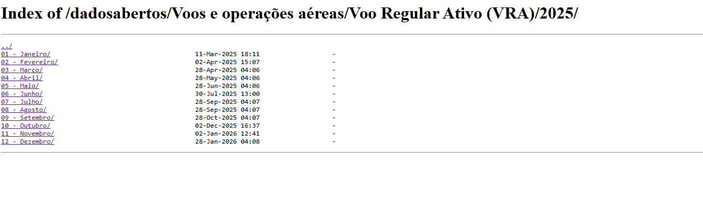

### 3.2 Como a coleta foi feita
1. Os 12 CSVs mensais foram **baixados manualmente** no navegador, no índice de arquivos de dados abertos da ANAC.
   O portal gov.br tem uma verificação anti-robô ("você é humano?") que impede o download automatizado. Respeitar
   essa barreira é uma questão ética e de termos de uso, por isso **não foi construído um robô para contorná-la**.
2. Os arquivos foram enviados para o **Volume** `/Volumes/workspace/mvp_voos/raw` do Databricks. A partir daí estão
   **persistidos na nuvem**.

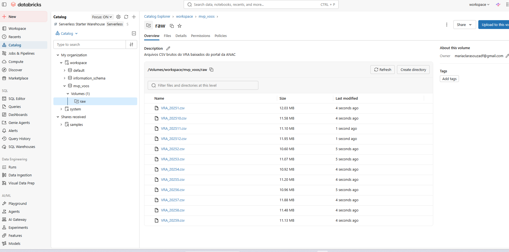

3. O notebook `01_coleta_bronze` lê todos os arquivos do Volume e grava a tabela Delta `bronze_vra`. O leitor foi feito
   para aguentar as variações de formato que a ANAC já usou:
   - detecta a **codificação** (UTF-8 ou Latin-1);
   - detecta o **separador** (`;` ou `,`);
   - **pula a linha "Atualizado em: …"** que vem antes do cabeçalho;
   - **padroniza os nomes das colunas** por meio de uma tabela de mapeamento. A ANAC mudou os nomes entre anos: em 2025,
     por exemplo, a coluna se chama *ICAO Aeródromo Origem*, e em anos anteriores se chamava *Sigla ICAO Aeroporto Origem*.
4. Cada execução registra na tabela `log_coleta` o arquivo, as linhas, o tamanho, o encoding e a data de ingestão.

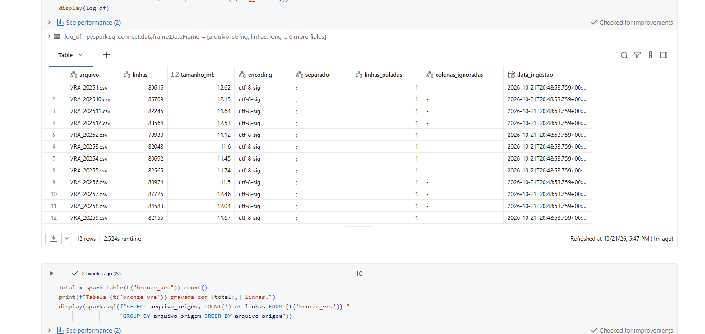

| Mês | Arquivo | Linhas | MB |
|---|---|---:|---:|
| Jan | VRA_20251.csv | 89.616 | 12,6 |
| Fev | VRA_20252.csv | 78.930 | 11,1 |
| Mar | VRA_20253.csv | 82.048 | 11,6 |
| Abr | VRA_20254.csv | 80.692 | 11,5 |
| Mai | VRA_20255.csv | 82.565 | 11,7 |
| Jun | VRA_20256.csv | 80.974 | 11,5 |
| Jul | VRA_20257.csv | 87.725 | 12,5 |
| Ago | VRA_20258.csv | 84.583 | 12,0 |
| Set | VRA_20259.csv | 82.156 | 11,7 |
| Out | VRA_202510.csv | 85.709 | 12,2 |
| Nov | VRA_202511.csv | 82.245 | 11,6 |
| Dez | VRA_202512.csv | 88.564 | 12,5 |
| **Total** | | **1.005.807** | **≈ 142** |

---

## 4. Modelagem

Os dados foram modelados num **Esquema Estrela** (Data Warehouse). O diagrama completo e a justificativa estão em
[`catalogo/modelo_estrela.md`](catalogo/modelo_estrela.md).

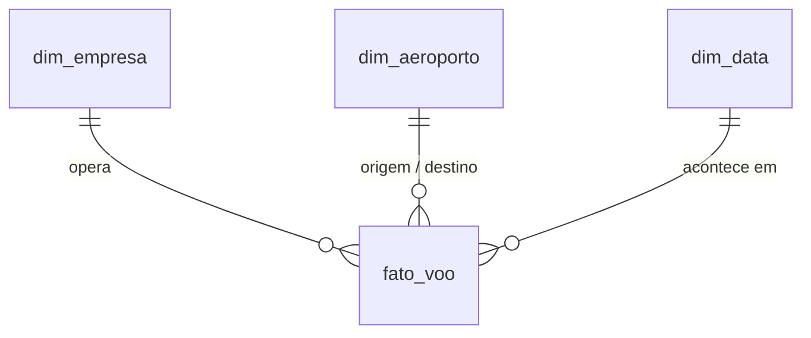

- **Fato `fato_voo`**, com grão de **uma etapa de voo**. Contém as métricas (`atraso_partida_min`, `atrasado_30`,
  `cancelado`…) e as chaves das dimensões.
- **`dim_empresa`**, com a chave ICAO da empresa.
- **`dim_aeroporto`**, com a chave ICAO do aeroporto. É uma *role-playing dimension*, usada como origem **e** como destino.
- **`dim_data`**, um calendário completo com mês, dia da semana e fim de semana.

**Integridade:** o notebook `03_modelagem_gold` verifica se alguma chave da fato não existe na dimensão
(chaves órfãs). Resultado: **0 órfãos** em todas as dimensões (empresa, origem, destino e data).

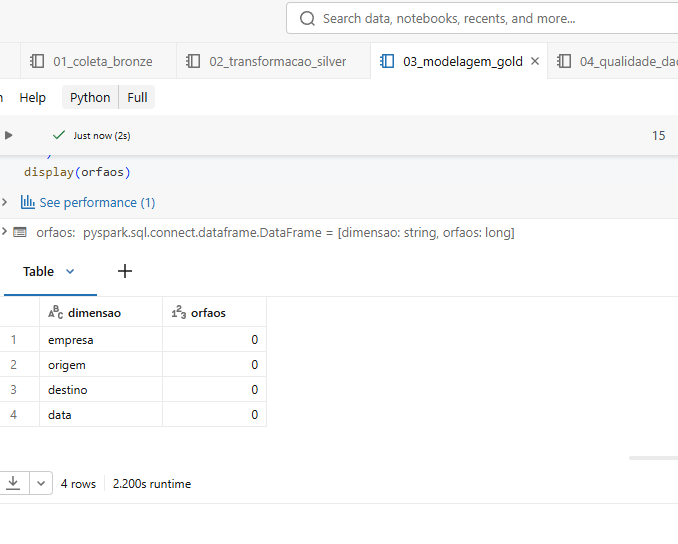

### Catálogo de Dados
O catálogo completo está em [`catalogo/catalogo_de_dados.md`](catalogo/catalogo_de_dados.md). Para **cada atributo**,
ele traz o tipo, a descrição, o **domínio esperado** (mín./máx. ou categorias), a obrigatoriedade (e o que o nulo
significa) e a **linhagem**: coluna de origem no CSV e transformação aplicada. As descrições também foram gravadas no
**Unity Catalog** do Databricks. 

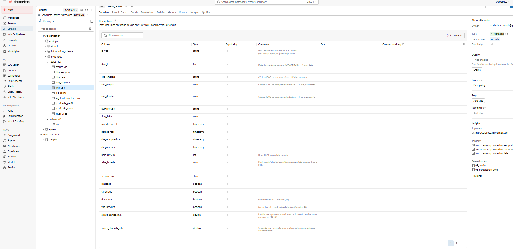

---

## 5. Carga (ETL)

O ETL roda **dentro do Databricks**, em notebooks PySpark encadeados: Extração (Volume → Bronze),
Transformação (Bronze → Silver) e Carga (Silver → Gold). As tabelas são gravadas em **Delta Lake** no Unity Catalog.

### 5.1 Regras de negócio da transformação
Estas regras mudam diretamente o resultado das análises, por isso estão explícitas:

| # | Regra | Justificativa |
|---|---|---|
| R1 | Remove espaços nas pontas; texto vazio, `N/A` e `null` viram nulo | Os arquivos de 2025 escrevem "ausente" como `null` (horários) e `N/A` (justificativa). Sem essa regra, esses textos contariam como valores reais |
| R2 | Códigos (empresa, aeroporto, situação) em maiúsculas | Chaves padronizadas para os *joins* |
| R3 | Datas aceitas em `dd/MM/yyyy HH:mm[:ss]` e `yyyy-MM-dd HH:mm[:ss]`, com **fração de segundo descartada** | **≈ 66 mil linhas de 2025 (6,6%)** trazem a partida prevista como `2025-03-01 10:00:00.000000000`. Sem esse tratamento, elas virariam nulo (detectado pelo teste Q8 e corrigido) |
| R4 | **Atraso = horário real − horário previsto, em minutos** | Métrica central. Valor negativo significa voo adiantado |
| R5 | O atraso só é calculado para voos **REALIZADOS** | Voo cancelado não tem atraso |
| R6 | Atraso fora de [−12 h, +24 h] é anulado | Remove erros de registro na origem que distorceriam a média |
| R7 | **Atrasado = atraso de partida > 30 min** | Critério de atraso da ANAC |
| R8 | **Doméstico de passageiros** = tipo de linha **N** e origem e destino com prefixo ICAO brasileiro (SB, SD, SI, SJ, SN, SS, SW) | O problema é do passageiro na malha doméstica. Exclui cargueiros (C, G) e internacionais (I) |
| R9 | Voo sem horário previsto (extra, fretado) fica fora das métricas de pontualidade | Sem horário previsto não há atraso a medir |
| R10 | **Deduplicação** por empresa + nº do voo + origem + destino + horário, mantendo a ingestão mais recente | O mesmo voo pode vir em dois arquivos |
| R11 | Faixa horária pela hora prevista: Madrugada 0–5h, Manhã 6–11h, Tarde 12–17h, Noite 18–23h | Base para testar a hipótese H1 |

**Enriquecimento das dimensões:** os arquivos de 2025 trazem **só códigos ICAO**, sem o nome da empresa ou do aeroporto.
Para que os resultados fiquem legíveis, o notebook `03_modelagem_gold` cruza os códigos com uma **tabela de referência**
(nome, cidade, UF e segmento passageiros/carga). Ela cobre todas as empresas com mais de 1.000 voos domésticos e todos
os aeroportos com mais de 1.000 partidas domésticas. Códigos fora da lista mantêm o próprio código como nome e ficam com
`nome_conhecido = false`.

### 5.2 Funil da transformação
Quantas linhas cada regra afeta (tabela `log_funil_transformacao`):

| Etapa | Linhas |
|---|---:|
| 1. Linhas na Bronze | 1.005.807 |
| 2. Após deduplicação (R10) | 1.005.746 |
| 3. Somente domésticos de passageiros (R8) | 804.857 |
| 4. Domésticos com horário previsto (R9) = **base de análise** | **789.690** |
| 5. … dos quais realizados | 775.623 |
| 6. … dos quais cancelados | 14.067 |

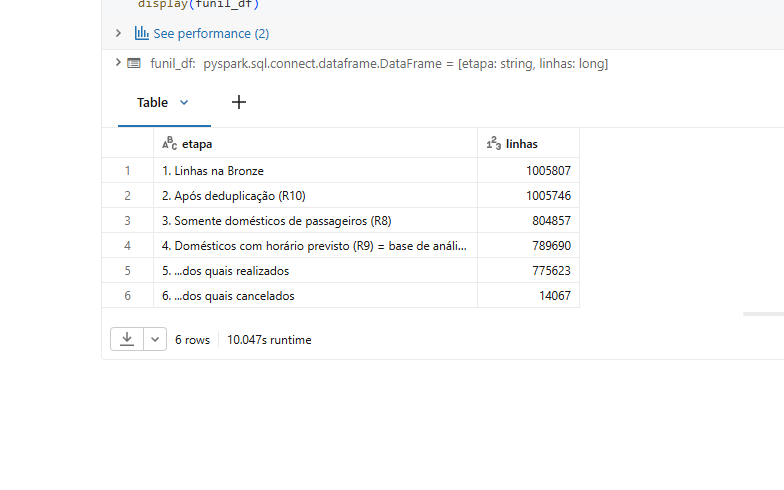

---

## 6. Análise de qualidade dos dados

O notebook `04_qualidade_dados` examina **todos os atributos** (perfil com % de nulos, valores distintos, mín./máx. e
valores mais frequentes) e roda 12 testes que cobrem as seis dimensões de qualidade:

| Teste | Dimensão | O que verifica | Registros | % | Tratamento |
|---|---|---|---:|---:|---|
| Q1 | Unicidade | Linhas duplicadas | 61 | 0,006% | Removidas (R10) |
| Q2 | Consistência | Cancelado com partida real preenchida | 0 | 0% | – |
| Q3 | Consistência | Realizado sem partida real | 0 | 0% | – |
| Q4 | Consistência | Chegada real antes da partida real | 0 | 0% | – |
| Q5 | Consistência | Origem = destino | 4.043 | 0,40% | Voos de retorno à origem. **Todos** são voos sem horário previsto (não programados), então já ficam fora da base pela R9 |
| Q6 | Conformidade | Código ICAO fora do padrão de 4 caracteres | 0 | 0% | – |
| Q7 | Conformidade | Situação fora de {REALIZADO, CANCELADO} | 0 | 0% | – |
| Q8 | Conformidade | Data presente no arquivo mas não convertida | 0 | 0% | Só ficou em 0 depois de criar a regra R3 (antes eram 103.523 linhas) |
| Q9 | Conformidade | Assentos fora de [0, 600] | 0 | 0% | Coluna não existe nos arquivos de 2025 |
| Q10 | Acurácia | Atraso implausível (< −12 h ou > 24 h) | 469 | 0,047% | Anulado (R6) |
| Q11 | Completude | Voo sem horário previsto (extra/fretado) | 28.196 | 2,80% | Fora da pontualidade (R9) |
| Q12 | Consistência | Empresa com mais de um nome | 0 | – | – |

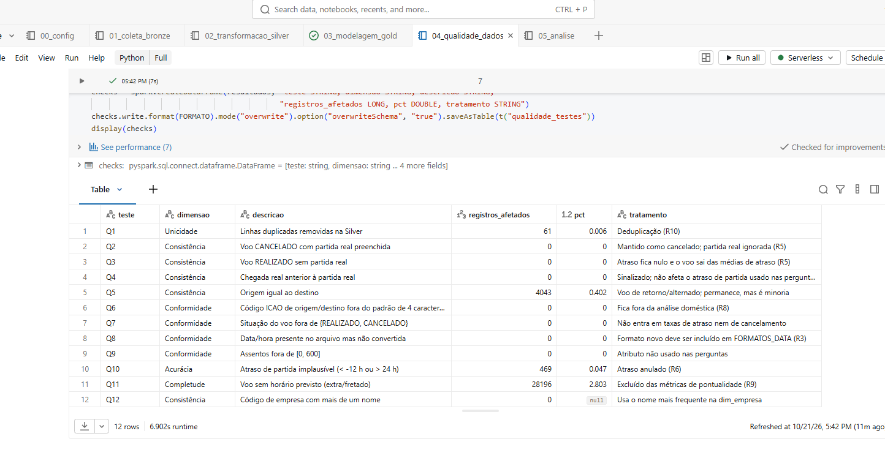

**Completude por atributo:** os 12 atributos que existem nos arquivos de 2025 estão completos (0% de nulos).
As exceções têm significado de negócio, não são erro:
- **Horários previstos:** 2,8% nulos. São voos extras ou fretados (Q11).
- **Horários reais:** 2,8% nulos. São os voos cancelados.
- **`codigo_justificativa`:** 100% `N/A`. A ANAC deixou de publicar o motivo do atraso, então **não é possível
  separar causas** (clima, tráfego aéreo, manutenção). Essa é uma limitação registrada na seção 11.
- **Nomes de empresa e aeroporto, modelo de aeronave, assentos e situação de partida:** não vêm nos arquivos de 2025.
  Os nomes foram supridos pela tabela de referência; os demais não são usados nas perguntas.

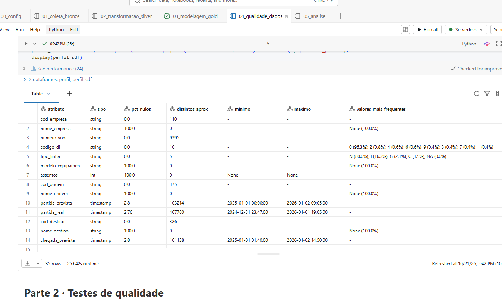

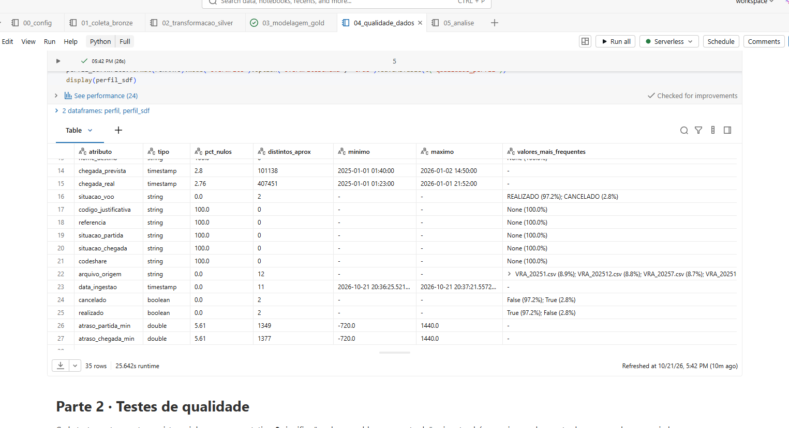

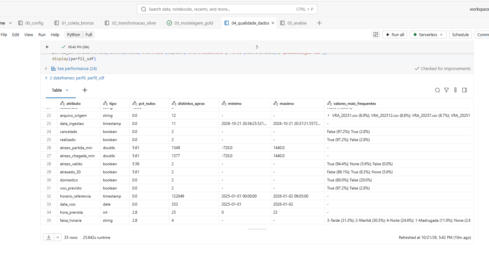

**Atualidade e cobertura:** os 12 meses estão presentes e o volume é estável: entre 61 mil (fevereiro, mês mais curto) e
69 mil (janeiro e dezembro) voos por mês na base de análise. Há **31 voos com data em 1º/01/2026**: são voos de 31/12
que partiram depois da meia-noite. Eles são descartados na análise mensal, que considera só meses com pelo menos
1.000 voos.

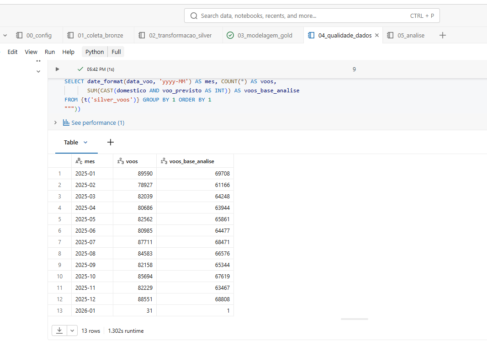

**Validação cruzada com uma fonte independente:** a ANAC classifica cada voo pelo tipo de linha, e nós classificamos
pelos códigos ICAO dos aeroportos (R8). As duas classificações concordam:

| Tipo de linha (ANAC) | Voos | % entre aeroportos brasileiros |
|---|---:|---:|
| N – doméstica mista | 804.857 | **100,0%** |
| C – doméstica cargueira | 15.241 | **100,0%** |
| I – internacional mista | 163.750 | 0,7% |
| G – internacional cargueira | 21.435 | 9,1% |
| (nulo) | 463 | 52,5% |

As linhas domésticas (N e C) são 100% entre aeroportos brasileiros. As poucas etapas "brasileiras" das linhas
internacionais são trechos domésticos de voos internacionais, como uma escala em Guarulhos antes de seguir para o
exterior. Por isso a regra R8 exige as **duas** condições.

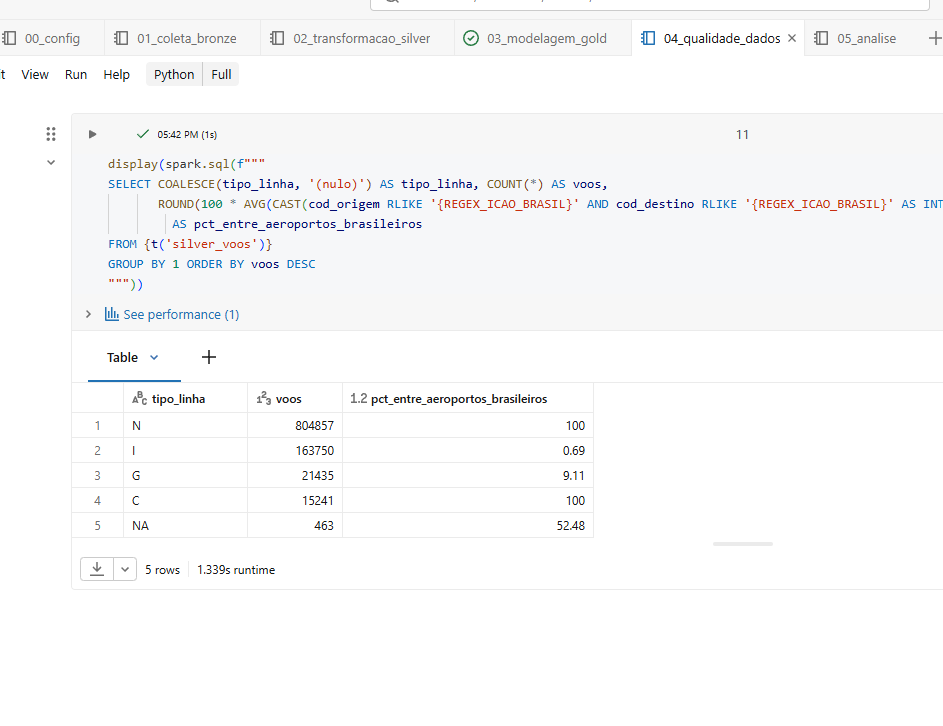

**Conclusão sobre a qualidade:** a base é **bem curada**. Os problemas encontrados afetam menos de 0,5% dos registros
(fora os extras, que são uma característica do negócio) e todos têm tratamento definido. O único problema sério, as
datas com fração de segundo, foi **detectado pelo próprio teste de qualidade** (Q8 = 10,4% na primeira execução) e
corrigido com a regra R3. Isso mostra o valor de testar a qualidade *antes* de analisar. A principal limitação é a
ausência da justificativa do atraso.

---

## 7. Solução do problema: respostas às perguntas

**Panorama geral (base de análise, 2025):** **789.690** voos domésticos de passageiros programados, **1,78%**
cancelados e **7,38%** com atraso de partida acima de 30 min. O atraso médio é de 4,5 min e a **mediana é de −2 min**:
o voo típico decola *antes* do horário. O problema está concentrado numa cauda de voos com atrasos grandes.

### P1 · Quais companhias atrasam e cancelam mais?
Companhias de passageiros com pelo menos 1.000 voos no ano:

| Companhia | Voos programados | % cancelados | % atraso > 30 min | Atraso médio (min) |
|---|---:|---:|---:|---:|
| Voepass (Passaredo) | 2.157 | 12,33 | **22,90** | 26,2 |
| Azul Conecta | 16.134 | 13,54 | 12,00 | 8,7 |
| Azul | 283.153 | 1,45 | 7,79 | 3,8 |
| LATAM Brasil | 263.811 | 1,70 | 7,72 | 5,5 |
| **Gol** | 219.009 | **1,07** | **5,93** | 3,9 |
| Abaeté | 1.291 | **14,48** | 1,73 | −5,9 |

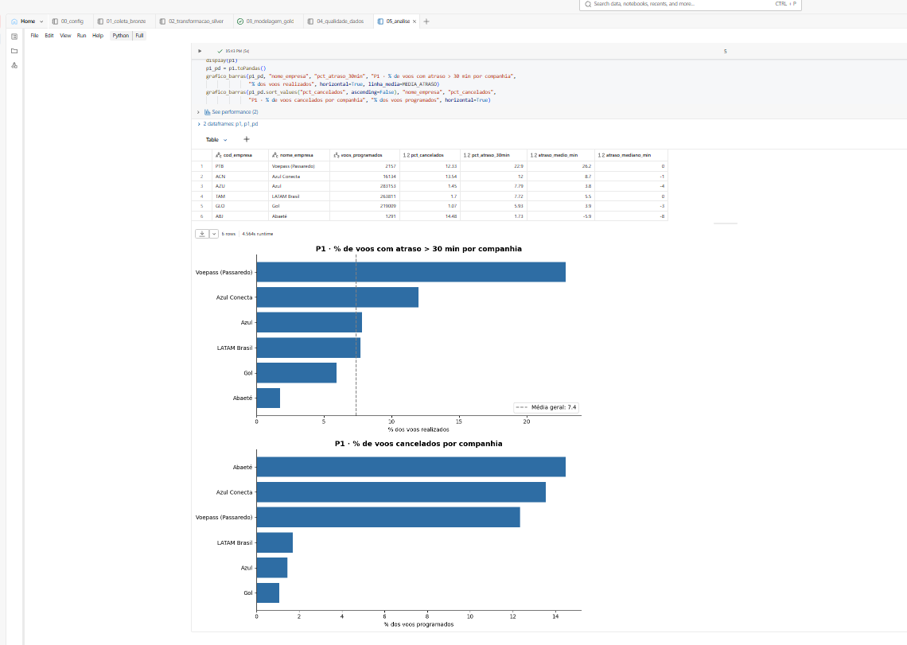

**Discussão:**
- Entre as três grandes, que fazem 97% dos voos, a **Gol foi a mais pontual e a que menos cancelou** (5,9% de atraso e
  1,1% de cancelamento). Azul e LATAM ficam praticamente empatadas, com ~7,7% de atraso. A diferença entre a melhor e a
  pior das grandes é de **1,9 ponto percentual**: real, mas modesta.
- As regionais têm risco muito maior, sobretudo de **cancelamento** (12% a 14%, quase 10× o das grandes). A Voepass
  teve as operações **suspensas pela ANAC em março de 2025**, por isso tem poucos voos no ano e indicadores extremos.
- A **Abaeté** mostra por que olhar só o atraso engana: tem a menor taxa de atraso (1,7%), mas cancela 14,5% dos voos.
  Uma companhia pode "parecer pontual" cancelando os voos problemáticos. Por isso o MVP mostra sempre as duas métricas.
- **Ressalva:** as companhias operam rotas diferentes. Parte da diferença vem *de onde* elas voam, não só *de como*
  operam (ver P2).

### P2 · Quais aeroportos têm a pior pontualidade? Onde fica Brasília?
Os 15 aeroportos com mais partidas, ordenados pela taxa de atraso:

| # | Aeroporto | Partidas | % atraso > 30 min | % cancelados |
|---|---|---:|---:|---:|
| 1 | **Guarulhos (SBGR)** | 97.062 | **10,93** | 1,44 |
| 2 | Confins (SBCF) | 55.949 | 8,30 | 1,60 |
| 3 | Viracopos (SBKP) | 53.799 | 7,90 | 1,84 |
| 4 | Congonhas (SBSP) | 94.136 | 7,61 | 1,74 |
| 5 | Afonso Pena – Curitiba (SBCT) | 25.258 | 7,41 | 2,43 |
| … | … | … | … | … |
| 13 | Salvador (SBSV) | 26.717 | 5,36 | 1,41 |
| 14 | Santos Dumont (SBRJ) | 29.133 | 5,34 | **2,76** |
| 15 | **Brasília (SBBR)** | 54.637 | **4,78** | **0,98** |

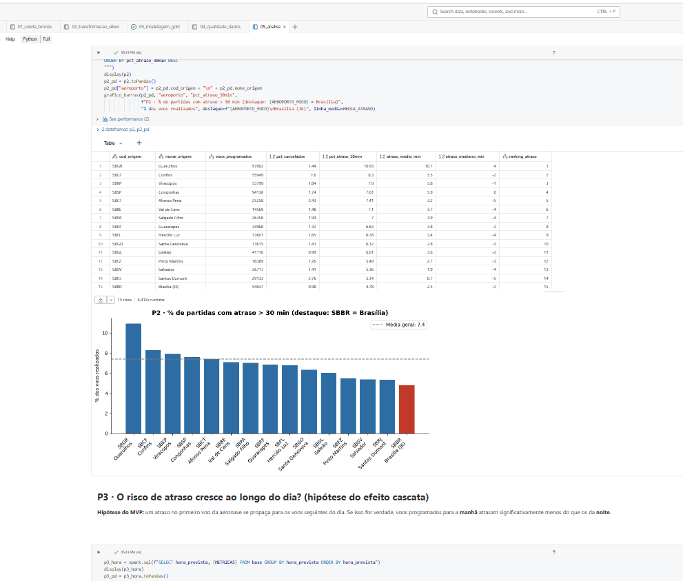

**Discussão:**
- **Brasília é o aeroporto mais pontual entre os 15 maiores**, com 4,8% de atraso (abaixo da média de 7,4%) e a menor
  taxa de cancelamento do grupo (1,0%). É uma boa notícia para o usuário-alvo: o risco de sair de BSB é baixo.
- **Guarulhos é o pior** (10,9%, ou seja, 1 em cada 9 voos), seguido de Confins e Viracopos. Os três são *hubs* de
  conexão: recebem aeronaves vindas de muitos lugares, e qualquer atraso na chegada vira atraso na partida seguinte.
- **Santos Dumont** tem pouco atraso (5,3%), mas é o que **mais cancela** (2,8%). Isso é coerente com um aeroporto de
  pista curta e sensível a mau tempo, onde a companhia prefere cancelar a esperar.

### P3 · O risco cresce ao longo do dia? (hipótese H1)

| Faixa horária (partida prevista) | Voos | % atraso > 30 min |
|---|---:|---:|
| Madrugada (0–5h) | 76.106 | 4,05 |
| **Manhã (6–11h)** | 257.974 | **5,36** |
| Tarde (12–17h) | 269.846 | 8,66 |
| **Noite (18–23h)** | 185.764 | **9,68** |

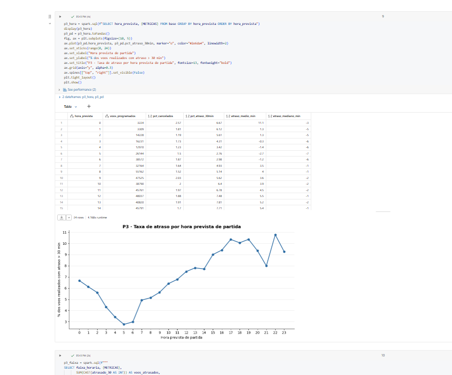

**Teste de hipótese (Manhã × Noite):**
```
Manhã: 5,36% de atraso  (n = 253.245)
Noite: 9,68% de atraso  (n = 182.768)
Diferença: +4,33 pontos percentuais | razão de risco: 1,81x
z = 54,62 | valor-p < 0,001  →  Hipótese SUSTENTADA
```

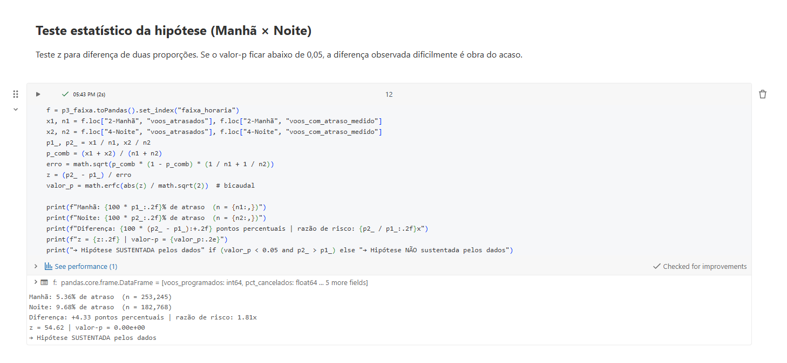

**Discussão:**
- **H1 é sustentada.** Um voo programado para a noite tem **1,8 vez** o risco de atrasar de um voo da manhã, e a
  diferença é estatisticamente significativa (z = 54,6; a chance de ser obra do acaso é praticamente nula).
- O gráfico por hora mostra o padrão de **efeito cascata**. O risco é mínimo nos primeiros voos do dia (**2,8% às 5h e
  3,0% às 6h**), quando os aviões saem "zerados" do pernoite. Ele cresce de forma quase contínua até o pico entre
  **17h e 22h (~10–11%)**.
- **Recomendação prática:** para compromissos importantes, prefira voos que partem **até 9h**. Isso reduz o risco de
  atraso à metade em relação aos voos do fim da tarde.
- **Ressalva:** o VRA não identifica a aeronave (matrícula), então não é possível seguir o mesmo avião ao longo do dia.
  O efeito cascata é **inferido** pelo padrão horário, que é exatamente o que ele preveria, mas não é observado avião a
  avião.

### P4 · Existe sazonalidade?

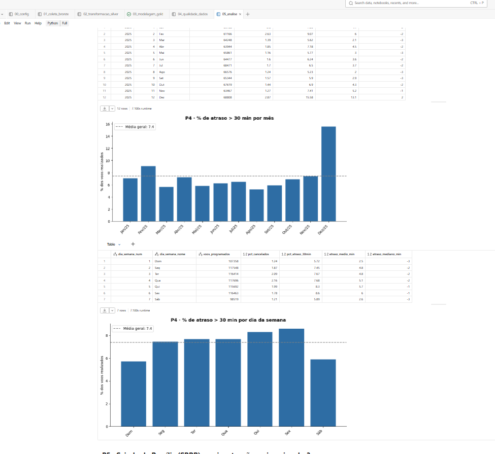

| Mês | % atraso > 30 min | % cancelados |
|---|---:|---:|
| Jan | 7,03 | 2,60 |
| **Fev** | **9,07** | 2,63 |
| Mar | 5,62 | 1,39 |
| Abr | 7,18 | 1,85 |
| Mai | 5,77 | 1,16 |
| Jun | 6,24 | 1,60 |
| Jul | 6,50 | 1,70 |
| **Ago** | **5,23** | 1,24 |
| Set | 5,90 | 1,57 |
| Out | 6,90 | 1,44 |
| Nov | 7,41 | 1,27 |
| **Dez** | **15,58** | **2,87** |


| Dia | Dom | Seg | Ter | Qua | Qui | Sex | Sáb |
|---|---:|---:|---:|---:|---:|---:|---:|
| % atraso > 30 min | **5,72** | 7,45 | 7,67 | 7,68 | 8,30 | **8,60** | 5,89 |

**Discussão:**
- **Dezembro é, de longe, o pior mês:** 15,6% de atraso, mais que o dobro da média e quase o triplo de agosto. Ele junta
  a maior demanda do ano (festas e férias) com as chuvas de verão. Janeiro e fevereiro, também de alta temporada e
  chuva, completam o período crítico, com os maiores índices de cancelamento (2,6%).
- **Agosto, março e maio são os meses mais tranquilos** (5,2% a 5,8%). É o período seco e de baixa temporada no
  Centro-Sul.
- **Na semana, o padrão segue a demanda corporativa:** sexta (8,6%) e quinta (8,3%) são os piores dias, e domingo e
  sábado (~5,8%) os melhores.
- **Ressalva:** com um único ano não é possível afirmar que o padrão se repete todo ano. Dezembro de 2025 pode ter tido
  um evento pontual. A extensão natural é carregar vários anos (seção 11).

### P5 · Saindo de Brasília, quais rotas são mais arriscadas?
Rotas a partir de BSB com pelo menos 100 voos no ano. "Risco" = atraso > 30 min **ou** cancelamento.

| Destino | Voos | % atraso | % cancel. | **% risco total** |
|---|---:|---:|---:|---:|
| **Guarulhos (SBGR)** | 4.603 | 6,87 | 1,63 | **8,39** |
| Viracopos (SBKP) | 2.841 | 6,44 | 1,62 | 7,96 |
| Confins (SBCF) | 3.062 | 6,74 | 0,69 | 7,38 |
| Manaus (SBEG) | 1.610 | 6,45 | 0,87 | 7,27 |
| Marabá (SBMA) | 626 | 6,59 | 0,64 | 7,19 |
| … | … | … | … | … |
| Congonhas (SBSP), a rota mais movimentada | 8.965 | 4,90 | 1,43 | 6,26 |
| Santos Dumont (SBRJ) | 4.386 | 2,57 | 1,69 | 4,22 |
| … | … | … | … | … |
| Natal (SBSG) | 940 | 2,77 | 0,11 | 2,87 |
| **Sinop (SBSI)** | 327 | 2,15 | 0,31 | **2,45** |

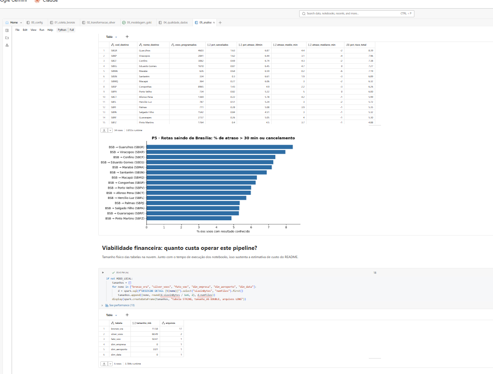

**Discussão:**
- As rotas mais arriscadas saindo de Brasília são justamente as que vão para os **hubs pior avaliados na P2**:
  Guarulhos, Viracopos e Confins. Isso confirma que o congestionamento do destino contamina a rota.
- Para quem vai a São Paulo, **Congonhas (6,3%) é mais seguro que Guarulhos (8,4%)**. E para o Rio, **Santos Dumont
  (4,2%) é mais seguro que o Galeão (4,6%)**, apesar de cancelar mais.
- **Ainda assim, todas as rotas saindo de BSB ficam abaixo da média nacional de atraso (7,4%).** Isso é coerente com a
  P2: Brasília é um bom ponto de partida.

---

## 8. Discussão geral

**Qual fator mais pesa?** Comparando a diferença entre o melhor e o pior valor de cada fator (amplitude, em pontos
percentuais de atraso > 30 min):

| Fator | Melhor | Pior | Amplitude |
|---|---|---|---:|
| **Mês** (P4) | Ago 5,2% | Dez 15,6% | **10,4 p.p.** |
| **Hora do dia** (P3) | 5h 2,8% | 22h 10,8% | **8,0 p.p.** |
| Aeroporto de origem (P2) | BSB 4,8% | GRU 10,9% | 6,2 p.p. |
| Dia da semana (P4) | Dom 5,7% | Sex 8,6% | 2,9 p.p. |
| Companhia, só as grandes (P1) | Gol 5,9% | Azul 7,8% | 1,9 p.p. |

**Conclusão:** *quando* se voa (época do ano e hora do dia) pesa muito mais do que *com quem* se voa. A companhia é o
fator de **menor** impacto entre as grandes. A exceção são as regionais, que têm um risco de cancelamento muito maior.
Isso contraria a intuição comum de que escolher a companhia certa é o principal.

**Recomendação para o gestor de viagens em Brasília:**
1. Para compromissos críticos, **reserve voos que partem até 9h**: o risco cai à metade.
2. **Em dezembro, preveja folga** na agenda (ex.: chegar na véspera). O risco de atraso dobra.
3. Para São Paulo, **prefira Congonhas a Guarulhos**.
4. Entre as grandes companhias a diferença é pequena. Em rotas regionais, **considere o risco de cancelamento**.

**Limites:** os dados mostram **associação, não causa**. Clima, controle de tráfego aéreo e manutenção não estão na
base, e a ANAC não publicou a justificativa dos atrasos em 2025.

---

## 9. Viabilidade do MVP

**Técnica:** o pipeline rodou ponta a ponta na nuvem, sobre **1 milhão de registros reais**. Todas as tabelas estão
persistidas no Unity Catalog, e o mesmo código também roda localmente com PySpark (testado), o que facilita a
manutenção.

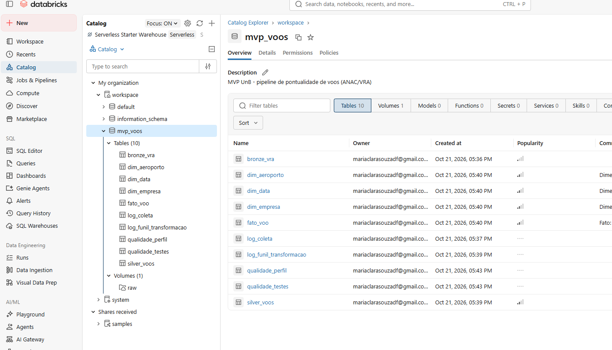

**Financeira:**
| Item | Valor |
|---|---|
| Plataforma usada | Databricks Free Edition: **R$ 0** |
| Dados brutos | ≈ 142 MB por ano (12 CSVs) |
| Volume armazenado (Delta) | **≈ 131 MB** no total: Bronze 11,6 MB · Silver 68,5 MB · Fato 50,5 MB · dimensões < 0,1 MB. O Delta comprime a Bronze de 142 MB (CSV) para 11,6 MB |
| Tempo de execução do pipeline completo | Poucos minutos por notebook na computação *serverless* (a célula mais demorada, a de leitura dos CSVs, roda em ~2–3 min) |
| Estimativa em produção | Uma execução mensal de poucos minutos em computação *serverless* custa poucos dólares por mês, e o armazenamento é desprezível. É compatível com uma ferramenta interna de política de viagens |

**Desejabilidade:** as respostas geram recomendações concretas e acionáveis para quem compra passagens (seção 8), como
horário, mês e aeroporto. Esse é o tipo de informação que hoje não está disponível na hora da compra.

---

## 10. Ética, licença e proteção de dados

- **Licença dos dados:** dados abertos governamentais publicados pela ANAC no seu portal de dados abertos e no
  Portal Brasileiro de Dados Abertos (dados.gov.br). Seguem a Política de Dados Abertos do Poder Executivo federal
  (Decreto nº 8.777/2016) e podem ser usados livremente, desde que a fonte seja citada (**Fonte: ANAC – VRA**).
- **Redistribuição:** os CSVs brutos **não foram versionados** no repositório. Eles são grandes e podem ser
  baixados diretamente da fonte oficial (seção 12). O repositório publica apenas o **código** e a documentação.
- **Dados pessoais (LGPD):** o VRA **não contém dados pessoais**, apenas dados operacionais de voos (empresa, aeroporto,
  horário). Nenhuma anonimização foi necessária.
- **Coleta:** a verificação anti-robô do portal foi respeitada; o download foi manual.
- **Licença do código:** MIT (arquivo `LICENSE`).

---

## 11. Autoavaliação

**1. Quais perguntas foram respondidas e quais não foram? Por quê?**
As cinco perguntas foram respondidas com os dados de 2025 completos, e a hipótese H1 (efeito cascata) foi
**sustentada** com alta significância estatística. Duas respostas ficaram parciais:
- **Causa dos atrasos:** o VRA de 2025 traz a justificativa como `N/A` em 100% dos registros, então não foi possível
  explicar *por que* dezembro ou Guarulhos atrasam mais. Só foi possível mostrar *que* atrasam.
- **Efeito cascata:** foi demonstrado pelo padrão horário, mas não avião a avião, porque o VRA não traz a matrícula da
  aeronave.

**2. Que limitações dos dados condicionaram os resultados?**
- Os arquivos de 2025 **não trazem os nomes** de empresas e aeroportos, só códigos ICAO. Foi preciso montar uma tabela
  de referência manual.
- A **justificativa do atraso** veio vazia, e não há dados de **clima** nem de **controle de tráfego**. Por isso os
  resultados mostram associações, não causas.
- **Um único ano** não permite afirmar que a sazonalidade (sobretudo o pico de dezembro) se repete.
- A taxa de atraso mede a **partida**. Um voo pode sair atrasado e chegar no horário (ou o contrário).

**3. Que decisões técnicas eu tomaria de outra forma?**
- **Rodaria os testes de qualidade antes de confiar na Silver.** Na primeira execução, 10% das datas não converteram
  porque a ANAC grava parte dos horários com fração de segundo (`.000000000`). O teste Q8 detectou o problema e a
  regra R3 o corrigiu, mas eu teria visto isso antes se tivesse inspecionado um arquivo de cada mês.
- Usaria **Lakeflow Declarative Pipelines (Delta Live Tables)** para declarar as regras de qualidade como
  *expectations* nativas, em vez de testes num notebook separado.
- Guardaria a tabela de referência de nomes como um **arquivo versionado** (CSV no Volume) em vez de um dicionário no
  código, para facilitar a manutenção.

**4. Que extensões transformariam o MVP numa solução de uso contínuo?**
- **Agendar** o pipeline (Databricks Jobs) para rodar todo mês, quando a ANAC publica o arquivo novo.
- **Carregar vários anos** para confirmar a sazonalidade e medir tendências.
- **Cruzar com dados meteorológicos** (METAR/INMET) por aeroporto e hora, para explicar parte dos atrasos.
- Um **painel** (Databricks SQL Dashboard) em que o gestor escolhe a rota e vê o melhor horário e a melhor companhia.
- Um **modelo preditivo** da probabilidade de atraso > 30 min por voo, usando as variáveis já modeladas.

---
