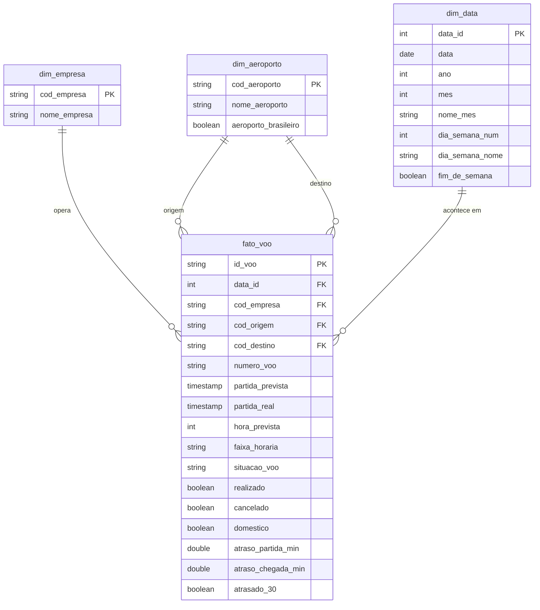
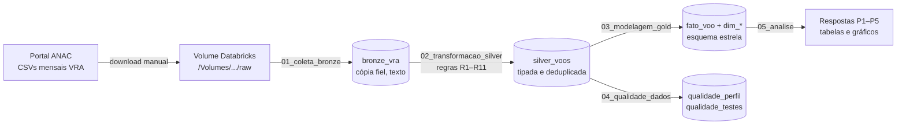

# Modelo de dados: Esquema Estrela

O GitHub desenha o diagrama abaixo automaticamente (sintaxe Mermaid).

## Por que um esquema estrela?

- **As perguntas de negócio são todas do tipo "taxa de atraso por X"**: por empresa, por aeroporto, por hora, por mês.
  O esquema estrela foi feito para isso. A métrica fica na fato e cada "X" é uma dimensão.
- **Consultas simples:** toda resposta é um `JOIN` da fato com uma ou duas dimensões e um `GROUP BY`.
- **Não precisa de Snowflake:** as dimensões são pequenas (dezenas de empresas, centenas de aeroportos).
  Normalizá-las em hierarquias não traria ganho e deixaria as consultas mais longas.
- **`dim_aeroporto` com papel duplo** (*role-playing dimension*): a mesma tabela é usada duas vezes, uma como origem
  e outra como destino, sem duplicar dados.

Pipeline completo (camadas):

